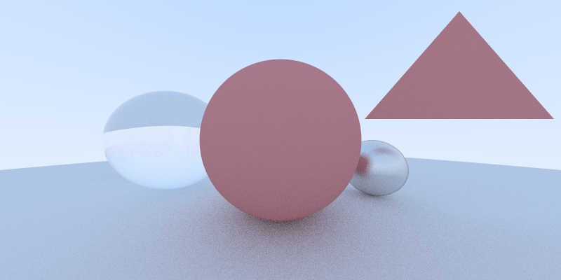

<p align="center"></p>

toy-raytracer is a Rust raytracer that renders one fixed scene to a PNG or PPM file using only the standard library.

---

**Contents**

- [Why it exists](#why-it-exists)
- [What exists in the project](#what-exists-in-the-project)
- [Features](#features)
- [Tech stack](#tech-stack)
- [Architecture](#architecture)
- [Data and limits](#data-and-limits)
- [Run your own copy](#run-your-own-copy)

## Why it exists

For every pixel, a renderer computes the colour that arrives along the ray leaving the camera through that pixel. The camera sits at the origin and looks down the negative z axis. Each ray follows its scattering path through the scene, bouncing at surfaces until it is absorbed, leaves the scene or reaches the bounce limit.

The scene, the camera and the random seed are constants in the binary. Two runs with the same options produce the same bytes, so the same fixed scene gives the same image every time.

## What exists in the project

- `README.md` gives this product overview.
- [Requirements](/docs/requirements.md) states what the program does.
- [Rendering](/docs/rendering.md) covers the camera, samples, the path loop, the sky and reproducibility.
- [Materials](/docs/materials.md) covers the material contract and the diffuse, metal and glass materials.
- [Geometry](/docs/geometry.md) covers the hit record, spheres, planes, triangles, bounding boxes and the scene list.
- [Command line](/docs/command-line.md) covers options, defaults, format selection and exit statuses.
- [Image output](/docs/image-output.md) covers channel conversion and the PPM and PNG layouts.
- `src/` holds the binary and its ray-tracing modules.
- `tests/` holds the command-line integration tests.

## Features

The [rendering](/docs/rendering.md), [materials](/docs/materials.md), [geometry](/docs/geometry.md), [command line](/docs/command-line.md) and [image output](/docs/image-output.md) pages describe these features in depth.

### The fixed scene and its three materials

Every render builds the same five objects: a diffuse sphere, a large diffuse ground sphere, a metal sphere, a glass sphere and a triangle. Each object carries one material. A diffuse surface scatters in a random direction around the normal and returns its albedo. A metal surface reflects about the normal with a fuzz factor. A glass surface refracts by its refractive index, reflects on total internal reflection and otherwise chooses reflection with Schlick's approximation.



### Jittered sampling with gamma 2

Each pixel averages 16 jittered samples by default, and `--samples` sets the count from 1 upward. A sample lands at a random point inside its pixel. The pixel colour is the average of its sample colours, and each channel becomes one byte through a gamma 2 correction.

### PNG and PPM output

The program writes 8-bit RGB images in PNG or PPM. The PNG writer builds the file in memory with one IDAT chunk of stored deflate blocks, so the pixel data is uncompressed. The PPM writer emits the plain-text `P3` form. The output extension selects the format, and `--format` overrides it.

### The command line and its progress line

`--width`, `--height`, `--samples`, `--output` and `--format` configure a run, and the defaults are 400 by 200, 16 samples and `render.png`. An invalid option prints an error and the usage line, then exits with status 2 before writing a file. While rendering, one progress line on standard error shows the share of finished rows.

## Tech stack

| Layer | Technology | Role |
| --- | --- | --- |
| Language | Rust, 2021 edition | Implements the renderer, the scene and the writers. |
| Libraries | Rust standard library | Provides the file, I/O, path and ownership types that the renderer uses. |
| Build | Cargo | Builds the binary and runs the tests. |
| Image output | In-repo PNG and PPM writers | Encode the pixels into the two file formats. |

## Architecture

`src/main.rs` owns the command line, the fixed scene, the render loop and the choice of output format. Each module owns one part of the ray tracing: vectors, rays, the camera, the hit record and scene list, bounding boxes, the shapes, the materials, the random generator and the PNG writer. A change to an option or to the scene starts in `src/main.rs`, and a change to a shape or a material starts in its module.

### Repository layout

| Path | Contents |
| --- | --- |
| [`src/`](/src/) | The binary and its ray-tracing modules. |
| [`tests/`](/tests/) | The command-line integration tests. |
| [`docs/`](/docs/) | The requirement and behaviour pages, the render-path diagram, the logo and the rendered scene image. |

## Data and limits

The scene, the camera and the seed are constants in the binary. A run reads no scene file, and the geometry comes from `src/main.rs`.

The renderer holds the whole image in memory as a list of pixel colours, encodes the image in memory and writes the file in one call. Rendering runs on one thread.

Each sample follows at most 50 bounces. A path that scatters on all 50 bounces without a miss or an absorption is black.

The PNG writer stores the scanlines in uncompressed deflate blocks. The file is close to 3 bytes per pixel, and a 400 by 200 image is 240,283 bytes.

## Run your own copy

The requirements are:

- A Rust toolchain with `cargo`, using the 2021 edition.
- The Rust standard library, which the toolchain provides.
- Write access to the directory that receives the output file.

1. Build the release binary.

   ```bash
   cargo build --release
   ```

   The build writes the binary to `target/release/toy-raytracer`.

2. Render the default image.

   ```bash
   cargo run --release -- --output render.png
   ```

   The command renders a 400 by 200 image with 16 samples, writes progress updates to standard error and writes `render.png`. Standard output is empty.

3. Run the tests.

   ```bash
   cargo test
   ```

   The command runs 17 unit tests and 3 command-line tests and reports each as passing.

The full option set is on [Command line](/docs/command-line.md).
