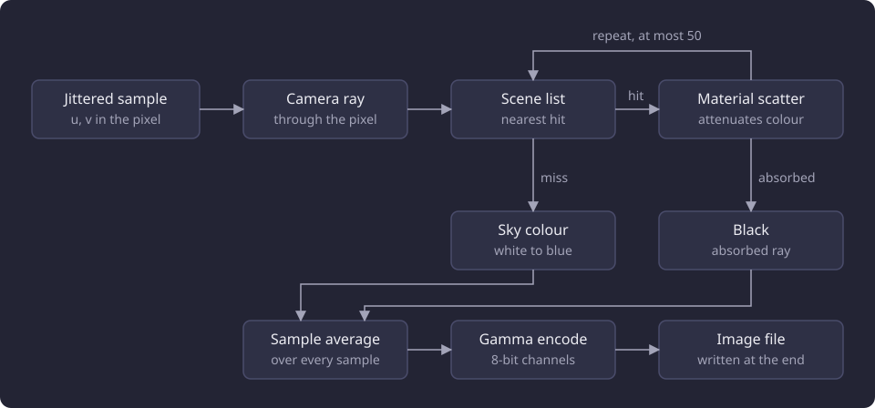

# Rendering a frame

One frame is a grid of pixel colours, each averaged from jittered camera rays that scatter through the fixed scene up to 50 bounces.

## The camera ray

The camera is a pinhole at the origin, looking down the negative z axis. Its viewport lies at `z = -1`, one unit in front of the origin, with a height of 2. The viewport width is twice the image aspect ratio, so it follows the image width divided by the image height. Every camera ray leaves the origin and passes through one point of the viewport.

Two coordinates name a viewport point, both in `0..=1`. The pair `(0, 0)` is the lower left corner and `(1, 1)` is the upper right corner. The ray direction is the vector from the origin to that point, so a larger first coordinate moves the point right and a larger second coordinate moves it up.

## Sampling a pixel

Each pixel receives a configured number of samples, set by the `--samples` option. The default is 16. [Running the program](/docs/running.md) covers the command line.

Every sample casts its own camera ray through a point jittered inside the pixel, so the samples of one pixel take slightly different paths. The jitter comes from the seeded generator, and the sample point lies inside the pixel's cell of the image grid.

The pixel colour is the sum of its sample colours divided by the sample count, taken before gamma correction. A larger sample count averages more paths. The sample count also changes the colours, because the jitter and the scatter directions of each sample come from a different part of the generator's sequence.

## The ray path

One sample's colour is built along a path that leaves the camera, bounces off materials and ends at the sky or at the bounce limit. The diagram shows that path and where its colour joins the image.

A sample's colour starts as white, the triple `(1, 1, 1)`. Each pass tests the ray against the [scene list](/docs/geometry.md) over the ray parameter range 0.001 to infinity. The lower bound prevents a scattered ray from hitting the surface it left, and the nearest hit decides.

- On a hit, the object's [material](/docs/materials.md) either scatters the ray or absorbs it.
- A scatter returns an attenuation and a scattered ray. The colour is multiplied component by component by the attenuation, and the scattered ray becomes the ray for the next pass.
- An absorbed ray ends the sample with black, `(0, 0, 0)`, whatever colour the path had gathered.
- A ray that hits nothing ends the sample with the gathered colour multiplied by the sky gradient.
- A path that scatters on all 50 bounces ends black.

The loop makes at most 50 passes, and a pass that scatters counts as one bounce. No ray is tested after the 50th scatter, so a path whose 51st ray would have missed is black.

## The sky gradient

A sample's colour multiplies by the sky gradient when its ray hits nothing. The gradient blends white, `(1, 1, 1)`, and light blue, `(0.5, 0.7, 1.0)`, by the y component of the unit direction. The blend factor is `(y + 1) / 2`, where `y` is that component. A ray pointing straight up gets light blue, a ray pointing straight down gets white, and every direction between them gets a mix.

## Gamma and the image bytes

Pixel colours stay linear until output. For each channel the program clamps the value to `0..=1`, takes its square root, multiplies by 255.999 and truncates to an integer byte. The square root is gamma 2 correction, so a channel of 0.25 becomes 127 and a channel of 1 or more becomes 255. [Image output](/docs/image-output.md) covers how the bytes are written.

## Reproducibility

The program creates one generator from the seed 7 and uses it for the pixel jitter and for every scatter direction. The draws happen in a fixed order, so the same width, height and sample count give the same pixel colours on every run. A different width, height or sample count gives each sample different jitter and different scatter directions, so the pixels change.

## Rendering order and progress

Rows render from the top of the image down. After each row the program writes a progress line to standard error of the form `N of M rows`, where N counts the rows finished and M is the image height. Each update overwrites the previous line, and the last row ends the line with a newline.
